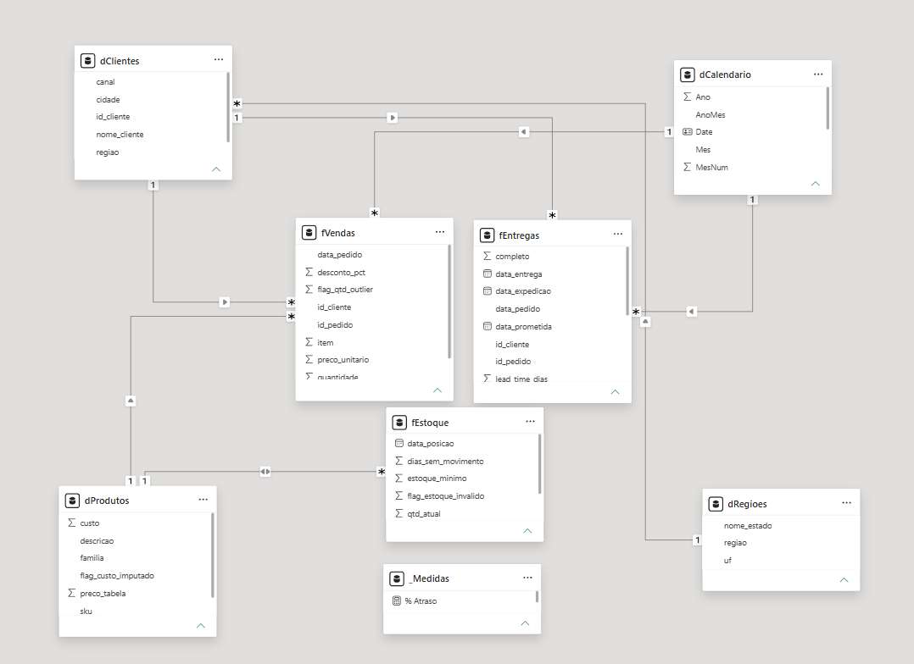
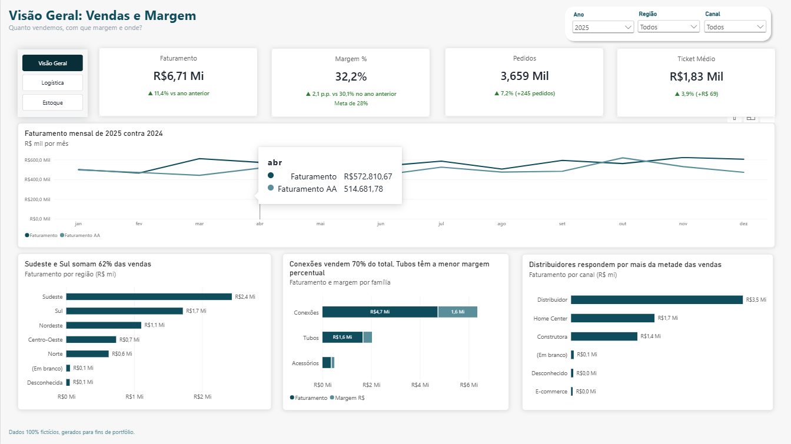
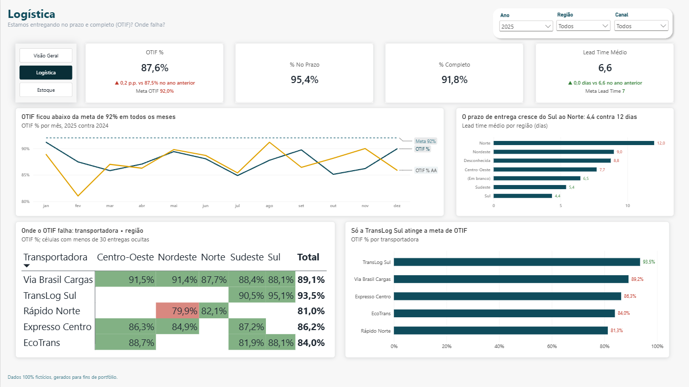
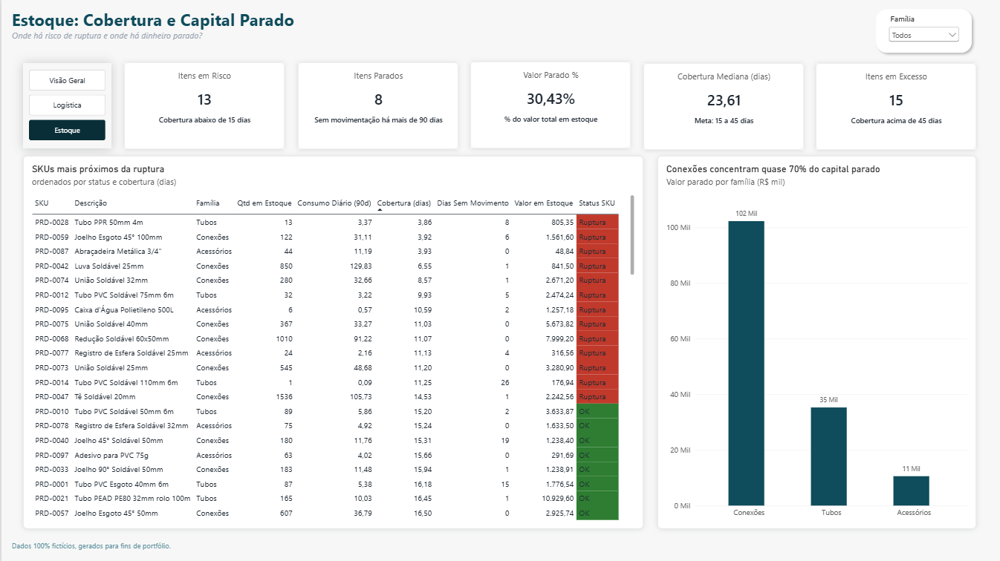

# Dashboard de Operações e Vendas: Materiais de Construção

> **Projeto de portfólio com dados 100% fictícios.** Os dados foram gerados por script (Python, semente fixa) para simular uma indústria de tubos, conexões e acessórios. Nenhuma informação real de empresa foi usada, e o projeto não tem relação com nenhuma marca. Qualquer semelhança de nomes é coincidência.

**Ferramentas:** Excel (tabelas dinâmicas, XLOOKUP, validações) · Power Query · Power BI (modelo estrela, DAX) · Python (geração dos dados)

**Período dos dados:** jan/2024 a dez/2025 · **Posição do estoque:** 31/12/2025

---

## Sumário

1. [Problema de negócio](#1-problema-de-negócio)
2. [Dados](#2-dados)
3. [Método](#3-método)
4. [Dashboard](#4-dashboard)
5. [Principais insights](#5-principais-insights)
6. [Premissas e limitações](#6-premissas-e-limitações)
7. [Como reproduzir](#7-como-reproduzir)
8. [Estrutura do repositório](#8-estrutura-do-repositório)
9. [Próximos passos](#9-próximos-passos)

---

## 1. Problema de negócio

Uma indústria fictícia de materiais de construção quer acompanhar, em um só lugar, o desempenho de **vendas**, **logística** e **estoque**. O dashboard responde a 7 perguntas:

| # | Área | Pergunta |
|---|---|---|
| 1 | Vendas | Como evoluem o faturamento e a margem, e como se comparam ao ano anterior? |
| 2 | Mix | Quais famílias de produto concentram o faturamento, e quais têm margem baixa? |
| 3 | Região e canal | Quais regiões e canais mais contribuem, e onde a margem é pior? |
| 4 | Entrega | Qual o OTIF geral, e como ele varia por transportadora e região? |
| 5 | Lead time | Qual o lead time médio, e onde ele está fora da meta? |
| 6 | Ruptura | Quais itens têm cobertura abaixo do mínimo e risco de ruptura? |
| 7 | Estoque parado | Quais itens estão parados, e quanto capital isso representa? |

### KPIs e metas (fictícias)

| KPI | Definição | Meta |
|---|---|---|
| Faturamento | Σ quantidade × preço × (1 − desconto) | n/a |
| Margem % | (Faturamento − Custo) ÷ Faturamento | ≥ 28% |
| OTIF % | Entregas no prazo **e** completas ÷ entregas válidas | ≥ 92% |
| Lead time médio | Data de entrega − data do pedido (dias) | ≤ 7 dias |
| Cobertura | Estoque atual ÷ consumo médio diário (90 dias) | 15 a 45 dias |
| Capital parado | Valor em estoque de itens sem movimentação há mais de 90 dias | n/a |

> As metas são fictícias e servem só de referência visual.

---

## 2. Dados

Seis tabelas em um único arquivo Excel, geradas pelo script em [`/script`](./script) (semente fixa, resultado reproduzível):

| Tabela | Conteúdo | Linhas (aprox.) |
|---|---|---|
| `vendas` | Itens de pedido | 20.000 |
| `clientes` | Cadastro com canal, cidade e UF | 400 |
| `produtos` | SKUs de tubos, conexões e acessórios, com custo e preço | 100 |
| `regioes` | UF → região | 27 |
| `entregas` | Uma linha por pedido (datas, quantidades, transportadora, status) | 7.000 |
| `estoque` | Posição por SKU em 31/12/2025 | 100 |

Os dados foram **sujos de propósito**, com problemas típicos de bases reais: duplicados, nulos, textos inconsistentes, datas e números gravados como texto, escalas erradas, outliers, valores negativos, chaves órfãs e registros incoerentes. Limpar essa base faz parte do projeto.

---

## 3. Método

### 3.1 Excel: diagnóstico e exploração

- Aba `diagnostico` com **56 verificações** (aba, coluna, regra violada, resultado, gravidade, tratamento planejado e justificativa), usando `COUNTBLANK`, `COUNTIF(S)`, `SUMPRODUCT`, `TRIM`/`LEN`/`EXACT` e XLOOKUP.
- Colunas auxiliares com **XLOOKUP** para validar chaves entre tabelas.
- Tabela dinâmica com segmentação e gráfico dinâmico (faturamento por família × ano).
- Detalhes em [`/docs`](./docs).

### 3.2 Power Query: limpeza

Cada passo está nomeado nas *Etapas Aplicadas* do `.pbix`. Resumo do log de qualidade:

| Tabela | Problema | Qtd. | Tratamento |
|---|---|---|---|
| vendas | Linhas duplicadas | 300 | Removidas (chave `id_pedido` + `item`) |
| vendas | Data como texto (dois formatos) | 799 | Convertida com localidade pt-BR |
| vendas | Preço como texto (vírgula decimal) | 201 | Convertido com localidade pt-BR |
| vendas | Preço vazio | 98 | Imputado com o preço de tabela; flag |
| vendas | Desconto em escala errada (10 em vez de 0,10) | 236 | Dividido por 100 quando ≥ 1 |
| vendas | Desconto vazio | 398 | Imputado com a mediana do canal; flag |
| vendas | Quantidade negativa | 59 | Valor absoluto; flag |
| vendas | Quantidade com erro ×100 | 11 | Corrigida pela mediana do SKU; flag |
| vendas | Quantidade vazia | 16 | Removida |
| vendas | SKU com espaço, caixa ou sem hífen | 5 | Padronizado (`PRD-0000`) |
| vendas | Cliente vazio ou inexistente | 78 | Recuperado pelo pedido; resto = `CLI-DESCONHECIDO` |
| clientes | Canal e UF com grafias diferentes | 25 | De-para para valores padrão |
| clientes | Cadastros duplicados | 12 | Removidos (mantido o id original) |
| produtos | Família com grafias diferentes | 6 | De-para para 3 famílias |
| produtos | Custo vazio ou maior que o preço | 5 | Imputado pela mediana da razão custo/preço da família; flag |
| produtos | SKU duplicado | 3 | Removidos |
| entregas | Pedidos repetidos | 80 | Removidos |
| entregas | Entrega sem pedido correspondente | 10 | Removidas |
| entregas | Transportadora com variações de grafia | 14 | Regra por palavra-chave, 5 nomes |
| entregas | Data como texto | 215 | Convertida com localidade pt-BR |
| entregas | "Entregue" sem data de entrega | 57 | Fora do OTIF e do lead time |
| entregas | Entrega anterior à expedição | 21 | Fora do OTIF e do lead time |
| estoque | SKU duplicado ou inexistente | 6 | Removidos |
| estoque | Quantidade negativa | 3 | Anulada; fora da cobertura |
| estoque | Última movimentação vazia ou "N/A" | 6 | Recuperada pela última venda do SKU |

**Antes × depois (exemplos do impacto da limpeza):**

| Medida | Antes | Depois |
|---|---|---|
| Linhas de vendas | 20.000 | 19.685 |
| Faturamento total (2024 + 2025) | R$ 14,46 mi | R$ 12,74 mi |
| Margem de Tubos | 30,3% | ≈ 23% |
| Margem total | 33,3% | 32.2% |

> Um valor vazio no custo é tratado como zero pelo DAX, sem erro nem aviso. Foi a validação contra uma segunda fonte que revelou que a margem de Tubos estava superestimada em cerca de 7 p.p.

### 3.3 Modelo estrela

- **Fatos:** `fVendas` (item de pedido), `fEntregas` (pedido), `fEstoque` (SKU na data de posição).
- **Dimensões:** `dCalendario`, `dClientes` (já com região), `dProdutos`.
- Relacionamentos 1:\* com filtro em um só sentido.
- `fEntregas` recebe `id_cliente` e `data_pedido` da tabela de pedidos, para se ligar direto às dimensões (evita relação muitos-para-muitos pelo `id_pedido`).
- `fEstoque` não se liga a `dClientes` nem a `dCalendario`; por isso a página de Estoque não usa as segmentações de canal, região e ano.



### 3.4 DAX: principais medidas

| Medida | Ideia |
|---|---|
| `Faturamento` | `SUMX` linha a linha (contexto de linha) |
| `Custo Total` | `SUMX` com `RELATED` para trazer o custo da dimensão |
| `Margem %` | `DIVIDE` (divisão segura) |
| `Faturamento AA`, `Var. vs AA %` | `CALCULATE` + `SAMEPERIODLASTYEAR` |
| `OTIF %`, `Lead Time Médio` | `CALCULATE` com filtro de validade (`valido_kpi = 1`) |
| `Consumo Diário (90d)` | `CALCULATE` + `REMOVEFILTERS` com janela fixa até a data da foto |
| `Cobertura (dias)` | Estoque ÷ consumo diário, por SKU |
| `Itens em Risco` | `FILTER` + `VALUES` com transição de contexto; `NOT ISBLANK` para não contar vazios |
| `Status SKU` | `SWITCH ( TRUE (), … )` com ordem de prioridade |

Código completo em [`/powerbi/medidas.md`](./powerbi/medidas.md).

---

## 4. Dashboard

Três páginas, com navegação e segmentações (ano, região e canal; família no estoque):

| Página | Pergunta | Principais visuais |
|---|---|---|
| **Visão Geral** | Quanto vendemos, com que margem e onde? | Cartões (faturamento, margem, pedidos, ticket médio) com variação vs ano anterior; evolução mensal 2025 × 2024; faturamento por região, família e canal |
| **Logística** | Estamos entregando no prazo e completo? Onde falha? | Cartões (OTIF, % no prazo, % completo, lead time); OTIF mensal vs meta; lead time por região; matriz transportadora × região; OTIF por transportadora |
| **Estoque** | Onde há risco de ruptura e dinheiro parado? | Cartões (itens em risco, parados, capital parado, cobertura mediana, excesso); tabela por SKU com status; valor parado por família |





---

## 5. Principais insights

Todos os números abaixo são de 2025, sem filtros adicionais, a menos que indicado. Dados fictícios.

**1. A margem total está acima da meta, mas Tubos estão bem abaixo.**
A margem foi de 32,2% (meta 28%), mas Tubos, ≈ 24% do faturamento, ficam em torno de 23%, contra ≈ 34% de Conexões e ≈ 41% de Acessórios.
*Recomendação:* rever a política de desconto de tubos para distribuidores, testar reajuste nos SKUs de menor margem e acompanhar a margem por família, não só a total.

**2. O crescimento é saudável, porém concentrado.**
Faturamento +11,4% (pedidos +7,2%, ticket +3,9%). Distribuidores respondem por 52% das vendas, e Sudeste e Sul por 62%.
*Recomendação:* metas de crescimento para home centers, Nordeste e Centro-Oeste, e monitorar a concentração como indicador de risco.

**3. O OTIF está abaixo da meta por entrega incompleta, não por atraso.**
OTIF de 87,6% (meta 92%): 95,4% no prazo, mas só 91,8% completas.
*Hipótese a investigar:* pedidos saem incompletos por falta de produto (13 SKUs com menos de 15 dias de cobertura).
*Recomendação:* acompanhar a taxa de atendimento do pedido e ligar a reposição dos itens em risco.

**4. Só uma transportadora atinge a meta, e o prazo cresce do Sul ao Norte.**
Lead time de 4,4 dias no Sul a 12 dias no Norte. A TransLog Sul (93,5%) é a única acima da meta de OTIF; Rápido Norte tem o pior resultado (81,3%).
*Recomendação:* metas de prazo por região, plano de melhoria com a Rápido Norte e teste de transportadora ou centro de distribuição regional para Norte e Nordeste.

**5. Cerca de 30% do capital em estoque está parado, e um SKU concentra a maior parte.**
≈ R$ 148 mil de R$ 487 mil estão parados há mais de 90 dias; o SKU PRD-0063 sozinho tem ≈ R$ 88 mil. Há 15 itens em excesso e 13 em risco de ruptura.
*Recomendação:* liquidar ou devolver o PRD-0063, revisar os parâmetros de estoque dos itens em excesso e em risco e adotar uma classificação ABC.

---

## 6. Premissas e limitações

- **Dados sintéticos:** os padrões (por exemplo, TransLog Sul só no Sul e Sudeste) foram definidos pelo script e não representam nenhum mercado real.
- **Custo único por SKU:** não varia no tempo, enquanto o preço de venda sobe de 2024 para 2025.
- **Quantidade negativa tratada como erro de sinal:** não há coluna de tipo de movimento; se fossem devoluções, o tratamento seria outro.
- **Imputações:** preço, desconto e custo imputados têm flag; são estimativas, e o impacto é pequeno (< 1% das linhas).
- **Pedidos "Em trânsito":** nulos legítimos, excluídos do OTIF e do lead time.
- **Cobertura:** consumo fixo nos 90 dias até 31/12/2025. Não responde às segmentações de data, canal e região, que não se aplicam ao estoque.
- **[PREENCHER: limitações visuais que restarem, por exemplo "(Em branco)" em região e canal]**

---

## 7. Como reproduzir

1. Instale o **Power BI Desktop** (gratuito, Windows).
2. Abra `powerbi/dashboard.pbix`.
3. Se pedir o caminho dos dados: **Transformar dados → Configurações da fonte de dados** e aponte para `dados/dados_ficticios_industria_materiais_construcao.xlsx`.
4. Para gerar uma nova base: `python script/gerar_dados.py dados/dados_novos.xlsx docs/gabarito_novo.json` (requer `pandas`, `numpy` e `openpyxl`). A semente é fixa (42).

---

## 8. Estrutura do repositório

```
.
├── README.md
├── dados/        # base fictícia (xlsx)
├── script/       # gerador de dados (Python)
├── powerbi/      # .pbix e medidas DAX
├── docs/         # diagnóstico de qualidade e análise no Excel
└── imagens/      # prints do dashboard, do modelo e das etapas aplicadas
```

---

## 9. Próximos passos

- Parâmetro de campo para alternar métrica nos gráficos.
- Curva ABC de SKUs e análise de sazonalidade.
- Cruzamento entre ruptura de estoque e entregas incompletas.
- Atualização automática com fonte de dados em banco (SQL).

---

*Projeto de estudo, sem fins comerciais. Dados fictícios.*
